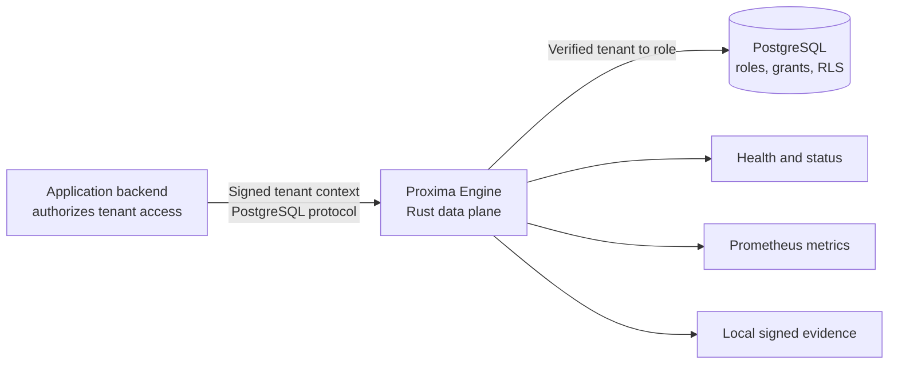
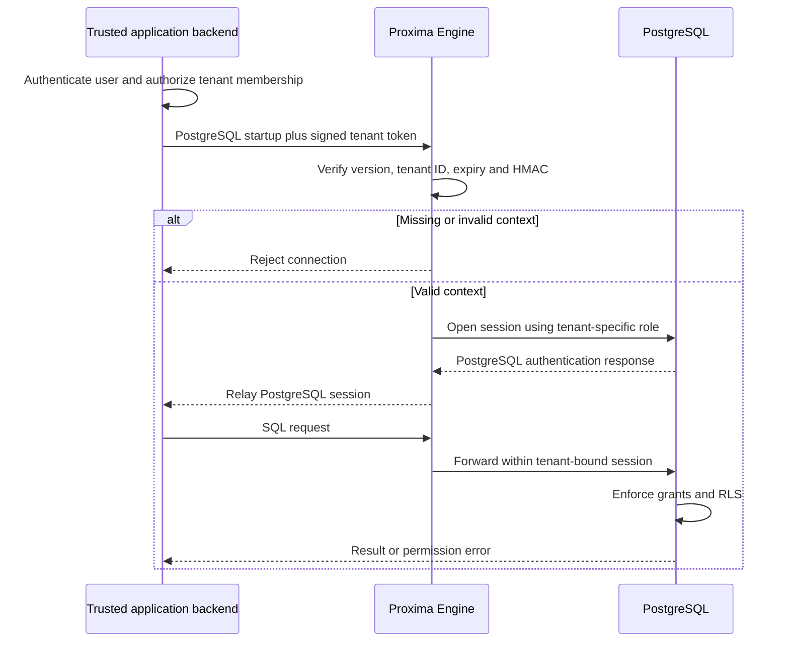
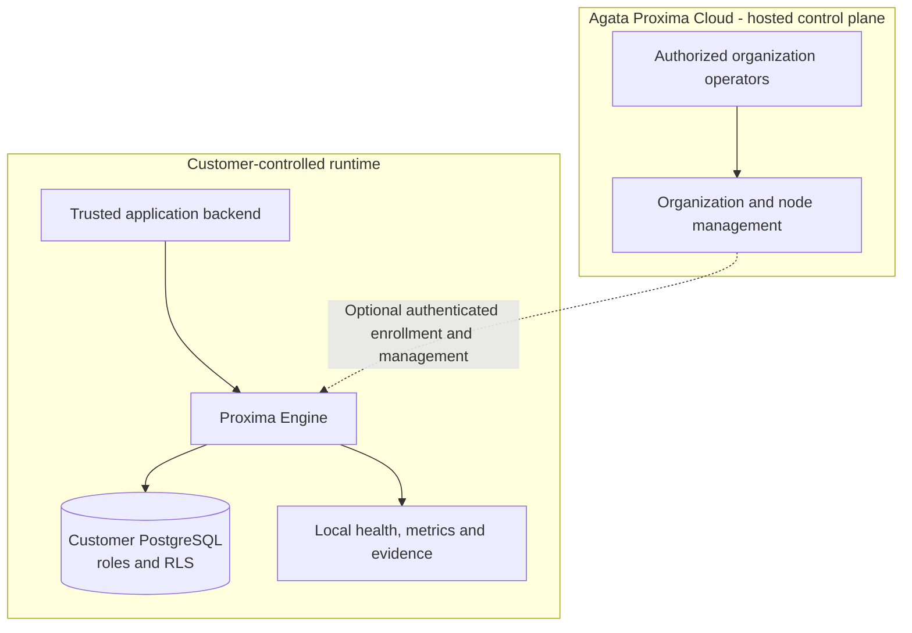

# AGATA PROXIMA

## PostgreSQL security infrastructure for multi-tenant applications.

**Make tenant identity part of the database connection boundary.**

[Website](https://agataproxima.com) · [Public Engine](https://github.com/Proxima-Engine/proxima-engine) · [Documentation](https://github.com/Proxima-Engine/proxima-engine/tree/main/docs) · [Discord](https://discord.gg/xsYSuDMzg)

---

Agata Proxima addresses a specific failure mode in shared-database applications: a request associated with one customer must not gain access to another customer's records because tenant identity was missing, altered, or incorrectly trusted somewhere in the application stack.

The engineering approach is to verify signed tenant context at the PostgreSQL connection boundary, bind the accepted session to a tenant-specific database role, and let PostgreSQL enforce data permissions through roles, grants, and Row-Level Security (RLS).

## Architecture



### Connection verification



The trusted application backend remains responsible for user authentication and tenant authorization. A tenant identifier supplied by an untrusted client is not authorization proof. PostgreSQL remains the final data-permission enforcement layer.

## The public Engine

**Proxima Engine is the public, MIT-licensed Rust data plane.** It is independently buildable and testable, and can run in local developer mode without a hosted account.

- **Signed tenant-context verification:** HMAC-SHA256 token version, tenant identifier, expiry, and signature validation.
- **Tenant-to-role routing:** binds an accepted connection to its tenant-specific PostgreSQL role.
- **PostgreSQL-native authorization:** database roles, grants, and RLS policies.
- **PostgreSQL wire protocol:** existing PostgreSQL drivers connect through the Engine.
- **Connection and TLS controls:** independently configured client and upstream connections.
- **Security operations:** peer-scoped violation breaker, break-glass token replay protection, and local signed attestation ledger.
- **Operational visibility:** local health/status routes and Prometheus metrics.
- **Developer verification:** Rust tests, PostgreSQL integration tests, and documented PgBouncer transaction-pooling tests.

These controls do not replace secure application authorization, PostgreSQL privilege design, secret management, network controls, or deployment review. The repository's security and deployment guides explain the responsibilities and configuration boundaries.

## Engine and Cloud are separate

| Component | Role | Availability |
|---|---|---|
| **Proxima Engine** | Rust PostgreSQL data plane: verifies tenant context and routes tenant-bound database sessions | Public source repository under its MIT license |
| **Agata Proxima Cloud** | Hosted control plane for organization and node management, hosted accounts, plans, and billing | Separate proprietary hosted product |



The hosted Cloud application and its private management source are not included in the public Engine repository. The Engine's MIT license does not grant access to hosted account features or private Cloud source.

## Start with the Engine

```bash
git clone https://github.com/Proxima-Engine/proxima-engine.git
cd proxima-engine
docker compose -f compose.dev.yaml up --build -d
```

The local Compose profile starts PostgreSQL, PgBouncer in transaction-pooling mode, and Proxima Engine. Check health and status:

```bash
curl -fsS http://127.0.0.1:9090/healthz
curl -fsS http://127.0.0.1:9080/api/status
```

Continue with the [Quickstart](https://github.com/Proxima-Engine/proxima-engine/blob/main/docs/QUICKSTART.md) to send a real SQL query through the Engine, inspect metrics, and stop the local stack.

## Developer documentation

| Guide | Purpose |
|---|---|
| [Quickstart](https://github.com/Proxima-Engine/proxima-engine/blob/main/docs/QUICKSTART.md) | Run the local stack and send SQL through the Engine |
| [Architecture](https://github.com/Proxima-Engine/proxima-engine/blob/main/docs/ARCHITECTURE.md) | Request lifecycle, trust boundaries, role routing, and system components |
| [Tenant isolation](https://github.com/Proxima-Engine/proxima-engine/blob/main/docs/TENANT_ISOLATION.md) | Tenant roles, RLS, signed context, and positive/negative tests |
| [Integrations](https://github.com/Proxima-Engine/proxima-engine/blob/main/docs/INTEGRATIONS.md) | psql, Node.js, Python, and Rust connection recipes |
| [Configuration](https://github.com/Proxima-Engine/proxima-engine/blob/main/docs/CONFIGURATION.md) | Environment variables, defaults, and validation |
| [Deployment](https://github.com/Proxima-Engine/proxima-engine/blob/main/docs/DEPLOYMENT.md) | Container deployment, TLS, networking, and persistence |
| [Security architecture](https://github.com/Proxima-Engine/proxima-engine/blob/main/docs/SECURITY.md) | Implemented controls and runtime security requirements |
| [Verification](https://github.com/Proxima-Engine/proxima-engine/blob/main/docs/VERIFICATION.md) | Tests, PostgreSQL integration, CI, and evidence |
| [Full documentation index](https://github.com/Proxima-Engine/proxima-engine/blob/main/docs/README.md) | Complete technical documentation |

## Work with the project

- **Inspect the implementation:** [Proxima Engine source](https://github.com/Proxima-Engine/proxima-engine)
- **Report a reproducible Engine issue:** [Open an issue](https://github.com/Proxima-Engine/proxima-engine/issues)
- **Propose a code change:** read the repository's [contribution guide](https://github.com/Proxima-Engine/proxima-engine/blob/main/CONTRIBUTING.md)
- **Report a security vulnerability:** follow the [private security policy](https://github.com/Proxima-Engine/proxima-engine/blob/main/SECURITY.md); do not publish exploit details in an issue.
- **Discuss the project:** [Join the Discord community](https://discord.gg/xsYSuDMzg)

## Project links

[Agata Proxima website](https://agataproxima.com) · [LinkedIn](https://www.linkedin.com/company/agata-proxima/) · [X](https://x.com/Worldtwins25) · [Discord](https://discord.gg/xsYSuDMzg)

---

**Agata Proxima — tenant identity verified at the database boundary.**
